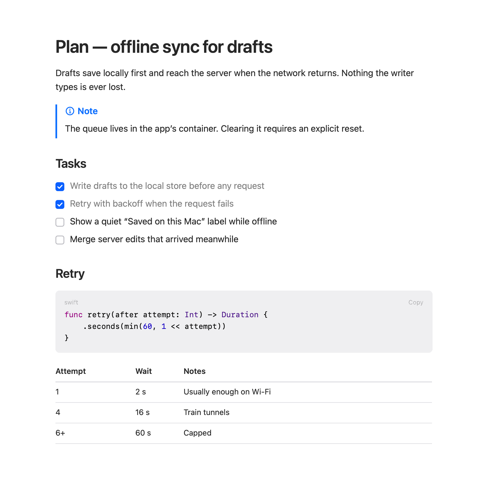

<h1 align="center">Typeset.md</h1>

<strong>A free, open-source Markdown reader for Mac</strong>

<a href="https://typeset.md">Website</a> · <a href="https://youtu.be/ad_0FR4OVeA">Watch 40s demo</a> · <a href="https://github.com/deeflect/typeset/issues/new?template=bug_report.yml">Report a bug</a> · <a href="https://github.com/deeflect/typeset/issues/new?template=feature_request.yml">Request a feature</a>

  

<picture><source media="(prefers-color-scheme: dark)" srcset="assets/hero-dark.png"></picture>

[Typeset.md](https://typeset.md) is a free, open-source native Markdown reader for Mac, for people who read the .md files their agents and repos produce. It runs on macOS 26 and costs nothing.

## Features

### Updates in place
Typeset.md reloads while an agent or editor rewrites the file. Only the changed part redraws, so your place stays put.

### What changed
A blue bar marks what is new since you last opened the file.

### Quote it back to your agent
Copy a passage along with its file path and line numbers.

### Links between files
Relative links between files work, and the outline lets you move around a long document.

### Fix the typo
Edit the source for small changes. Ticking a checkbox writes back to the file.

### Hand it on
Print, save a PDF, or copy out as rich text for Pages, Word and Google Docs.

## Download

[Download the latest Typeset.md for Mac](https://github.com/deeflect/typeset/releases/latest) from the releases page. It is a signed and notarized DMG: open it and drag Typeset to Applications. The app is free and needs macOS 26 Tahoe. Once it is installed, double-click a .md file and it opens rendered.

A Mac App Store version is waiting for review and is not listed yet.

## Build from source

The full source of the app is in this repo. You need Xcode 26.3 or later and XcodeGen. The steps are in [BUILDING.md](BUILDING.md).

## Limits

Typeset.md has no plugins and no themes, only one light look and one dark look. No AI is built in: the app shows what your agent wrote.

## Questions

### How much does Typeset.md cost?
Nothing. Typeset.md is free and open source.

### Does Typeset.md need an account?
No. You open the app and open a file. The app has no internet access, because its sandbox does not allow it.

### What happens to my files?
Typeset.md leaves them where they are, with no library or vault. Edits and ticked tasks are written back to the file you opened.

## Feedback

I read every issue, and I want your [bug reports and feature requests](https://github.com/deeflect/typeset/issues). A useful bug report gives the app version, the system version and the steps that lead to the bug.

## License

Typeset.md is open source under the [AGPL-3.0](LICENSE). You can use it, read it, change it and share it; a version you distribute has to stay open under the same licence. The name and icon are not part of the licence, so a fork needs its own. To contribute, see [CONTRIBUTING.md](CONTRIBUTING.md).

## Made by

Typeset.md is made by [Dee (deeflect)](https://deeflect.com), a one-person studio.
