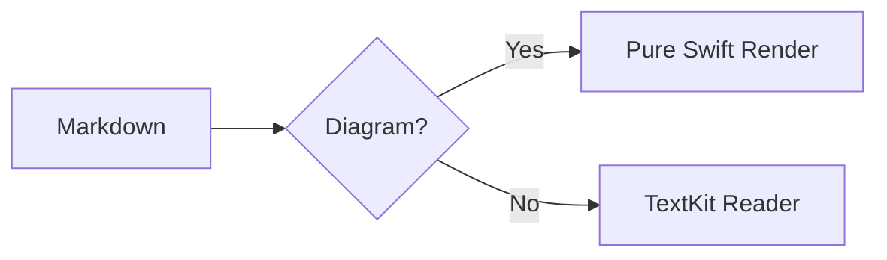
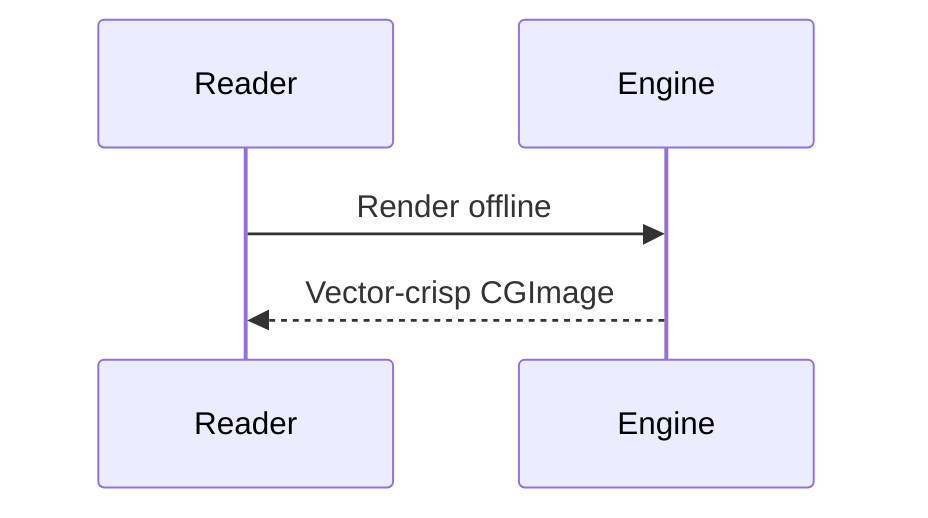

# Diagrams & Math (Offline)

Inline math sits on the text baseline like $E = mc^2$ and $\frac{-b \pm \sqrt{b^2 - 4ac}}{2a}$, while prices like $5 and $10 remain plain prose. GitHub's inline code math form $`a^2 + b^2 = c^2`$ also works.

Display math centers cleanly:

$$
\int_{-\infty}^{\infty} e^{-x^2}\,dx = \sqrt{\pi}
$$

## Flowchart



## Sequence Diagram



## Fallback on Broken Diagram

```mermaid
flowchart TD
    A -->
```
